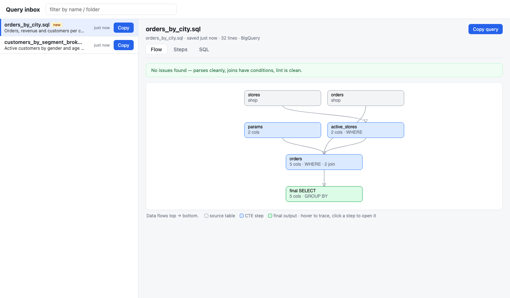
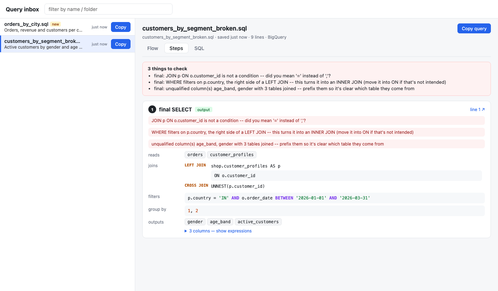

# Query inbox

A tiny localhost page that lists the `.sql` files you (or your coding agents) saved recently, gives each a
**Copy** button, and opens any query in a viewer that makes it easy to read and proofread before you run it.

Built for a workflow where several AI-agent sessions write queries to disk and you paste them into a web
SQL console: no more opening each file in an editor to copy it, and no fighting over one shared clipboard.



## What it does

- **Inbox**: every `.sql` file saved under a folder in the last few days, newest first, with the first
  line of its header comment as a description. Copy buttons remember what you've already copied; an edit
  to the file resets that. The list refreshes every 10 seconds, and an open query reloads when its file
  changes.
- **Flow**: a top-to-bottom diagram of source tables, each CTE, and the final SELECT. Hover to trace
  edges, click a step to open it.
- **Steps**: one card per CTE: what it reads, its joins with their ON conditions, filters, GROUP BY,
  HAVING / QUALIFY and output columns (expand to see each expression).
- **SQL**: highlighted, line-numbered source; the line a parse error points at is marked.
- **Checks** that catch common slips:
  - the query doesn't parse (with the line);
  - `JOIN ... ON a.id, b.id`: a comma where `=` was meant;
  - a WHERE filter on the right side of a LEFT JOIN, which silently makes it an INNER JOIN;
  - unqualified columns when several tables are joined;
  - duplicate aliases, and output names with spaces;
  - plus anything your own linter reports (see `--lint`).



## Run it

```bash
pip install -r requirements.txt      # just sqlglot
python serve.py --root ~/my-sql-workspace
# open http://127.0.0.1:8765
```

Options:

| flag | default | |
|---|---|---|
| `--root` | current folder | folder to scan (recursively) for `.sql` files |
| `--port` | `8765` | |
| `--days` | `3` | how far back the list goes |
| `--lint` | none | a `.py` file defining `lint(sql) -> list[str]`; its notes show under the checks |

Link straight to one query (handy for an agent to hand you): `http://127.0.0.1:8765/#p=<path relative to
root>`, plus `&t=steps` or `&t=sql` to pick the tab.

Try it on the bundled examples: `python serve.py --root examples`.

## Notes

- Binds to `127.0.0.1` only, and only serves `.sql` files inside `--root`.
- Queries parse as BigQuery SQL; a file whose name contains `spark` parses as Spark SQL. Parsing is
  [sqlglot](https://github.com/tobymao/sqlglot), so other dialects are a one-line change in `sqlviz.py`.
- Copies of a file inside Claude Code worktrees (`.claude/worktrees/<name>/...`) are hidden when they match
  the main checkout, and tagged with the worktree name when they differ.
- Three files, no build step: `serve.py` (stdlib HTTP server), `sqlviz.py` (query breakdown + checks;
  `python sqlviz.py` runs its self-check), `index.html` (the page, plain JS).

## License

MIT
